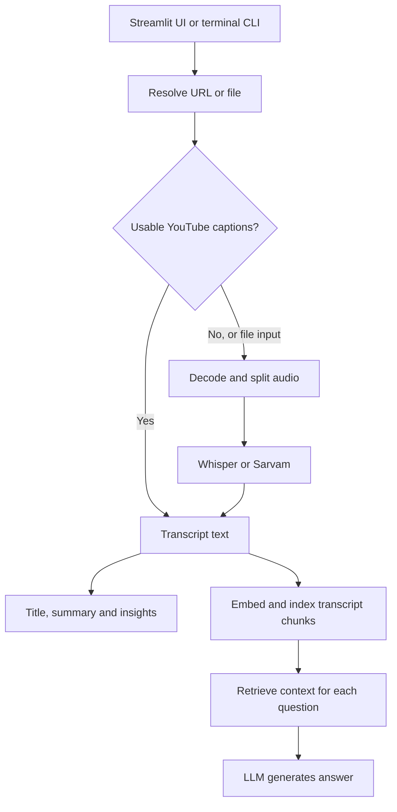

# AI Video Assistant — Project Description and Interview Guide

**Pushpendra Choure** · Python, Streamlit, LangChain, Whisper, Sarvam AI, ChromaDB, Hugging Face embeddings  
[GitHub repository](https://github.com/pushp2566/AI-Video-Assistant) · [Live demo on Streamlit Cloud](https://ai-video-assistant-dazevw4wymcq5f6nd2735a.streamlit.app/)

## How to study from this file

Copy this prompt after attaching the guide in a new chat.

> Use the attached guide to teach me my AI Video Assistant project for an SDE interview. Assume I know basic programming. Define AI terms before using them. Teach one lesson at a time and wait for my “Next.” Start with what the user enters and sees. Then cover input routing, speech-to-text, LLM summaries and extractions, RAG indexing and retrieval, Streamlit session state, deployment, and testing. Trace the same sample through the whole pipeline, show the relevant file and function names, and end every lesson with two interview questions. Use the guide’s verified results and limitations when discussing résumé claims. Label illustrative examples and proposed improvements.

| Lesson | What you should be able to explain |
| --- | --- |
| 1. App overview | Why the app exists, who uses it, what goes in and what comes out. |
| 2. Ingestion and transcription | Where YouTube captions come from, when audio is downloaded, and how Whisper and Sarvam are selected. |
| 3. LLM generation | What a prompt is, how the model is selected, and why long summaries use map-reduce. |
| 4. RAG | How the transcript is indexed once and how each question retrieves and uses relevant passages. |
| 5. App runtime | Why Streamlit reruns, what stays in session state, what a new analysis resets, and how local execution differs from hosting. |
| 6. Interview practice | Explain the code, then defend each résumé bullet and discuss verification, failure cases, and improvements. |

## 30-second interview pitch

I built and deployed a Streamlit app that turns YouTube links and uploaded recordings into searchable transcripts. It can reuse YouTube captions or transcribe audio using local Whisper for the English path and Sarvam for Hinglish speech-to-English translation. LangChain generates a title, a summary, and meeting insights. The chat feature retrieves relevant chunks from a ChromaDB collection created for the current analysis and passes those chunks to an LLM to answer the question.

## Résumé bullets

- Built and deployed an app on **Streamlit Cloud** that turns YouTube videos and uploaded recordings into transcripts, summaries, and interactive Q&A.
- Implemented a **caption-first YouTube pipeline** using a RapidAPI transcript endpoint and `youtube-transcript-api`, with **yt-dlp** as an audio fallback and **FFmpeg** for preprocessing.
- Integrated **Whisper** for English audio and **Sarvam AI** for Hinglish-to-English transcription. Used **LangChain** to generate titles, summarize long transcripts in stages, and extract action items, key decisions, and open questions.
- Built **transcript-grounded RAG** with **all-MiniLM-L6-v2** embeddings and **in-memory ChromaDB**, retrieving up to four relevant passages from a separate collection for each analysis.

## What was verified

| Check | Observed result |
| --- | --- |
| Streamlit Cloud deployment | The public demo was asleep initially and loaded after waking. |
| Hosted YouTube analysis | The [repository’s sample video](https://www.youtube.com/watch?v=_Q-e_nczWqM) produced a transcript, title, summary, key decisions, and open questions. Results were visible about two minutes after clicking **Analyse**, with the app already awake. |
| Hosted transcript Q&A | Asked what billing model GitHub Copilot switched to. The app answered **token-based billing**, consistent with the transcript. The answer was visible within 17 seconds of submission. |
| Local audio preprocessing | A three-second MP3 was converted to 16 kHz mono WAV. A 601-second WAV was split into chunks of 600 seconds and one second. |
| Remaining verification | Hosted audio uploads through Whisper or Sarvam and the active hosted LLM provider remain unverified. The YouTube run did not establish which caption or audio path it took. |

The timings are observations from one sample. They describe time to visible output and provide no separate measurements for caption extraction or model inference. Use the deployment claim on the résumé. Typical latency and reliability would require repeated measurements across inputs. The code supports Groq with `openai/gpt-oss-20b` as its default when selected. Name the deployed model only after checking the hosting configuration.

## System flow

1. **Input.** In `app.py`, the user uploads media or enters a URL or server-side file path, selects English or Hinglish, and clicks **Analyse**. An upload takes precedence. The uploader accepts `.mp4`, `.mp3`, `.wav`, `.m4a`, `.webm`, and `.mkv`. A typed local path is resolved by the process running Streamlit. A hosted app cannot read a path on the visitor’s laptop.
2. **Get transcript or audio.** `process_input()` returns either a caption string or a list of paths to WAV chunks. Captions take the fast path because they bypass downloading, audio conversion and speech-to-text.
3. **Build the transcript.** `transcribe_all()` returns an existing caption string unchanged. For WAV chunks, it calls the selected speech-to-text engine in order and joins the text.
4. **Generate insights.** LangChain calls the configured LLM to generate a title, summarize the transcript, and extract action items, key decisions/main takeaways, and open questions.
5. **Index the transcript.** The app chunks and embeds the original transcript, creates a fresh in-memory Chroma collection, and builds a retriever for it.
6. **Serve results and Q&A.** Streamlit stores the result and RAG chain in the current session. Each question retrieves transcript chunks and makes a fresh LLM call.

### Architecture at a glance



The two branches from the transcript show how the data is used. The current implementation generates the title, summary, and insights first, then builds the RAG index.

### Pipeline in pseudocode

```text
ON ANALYSE(source, language)
  raw = process_input(source)                   # caption text OR WAV paths
  transcript = transcribe_all(raw, language)   # existing captions pass through
  title = generate_title(transcript)
  summary = summarize(transcript)
  action_items = extract_action_items(transcript)
  key_decisions = extract_key_decisions(transcript)
  open_questions = extract_questions(transcript)
  rag_chain = build_rag_chain(transcript)
  keep the transcript, generated outputs, and chain for the active analysis

ON SEND(question)
  context = retrieve up to four passages from the active transcript index
  answer = generate from the question and context
  append the question and answer to the displayed chat history
```

The web app keeps the result and chat history in `st.session_state`, a per-session place to keep data across UI reruns. The CLI holds its result in memory while the terminal program is open. A new web analysis clears the previous visible result and chat before processing. During analysis, an exception can stop the sequence before a result is saved and is shown in the UI.

## Ingestion and speech-to-text

| Step | What the code does | Interview follow-up |
| --- | --- | --- |
| YouTube ID and captions | Extracts an 11-character video ID with regex. Tries the `youtube-transcript3` RapidAPI endpoint first when a key is configured (12-second request timeout). Then tries `youtube-transcript-api` instance `list()`, instance `fetch()`, and older static methods when available. Accepts returned text longer than 20 characters. | The app integrates a hosted transcript endpoint. Its provider’s underlying proxy infrastructure is unverified. Caption text is flattened, so segment timestamps are discarded. The caption path has no language matching or translation step tied to the UI picker. |
| Audio fallback | If caption retrieval fails, `yt-dlp` attempts an audio/media download using several client configurations. A download exception containing `403` or `Forbidden` produces an upload suggestion. | Upload is a separate input option the user must choose. Caption access and downloads can still fail. |
| WAV preprocessing | `pydub` and FFmpeg decode media and export 16 kHz mono WAV. The app then makes non-overlapping WAV chunks of up to 10 minutes. | This creates a consistent audio format. The process loads the audio into memory, so file size and duration matter. Fixed cuts can split speech mid-sentence. |
| English audio | Loads the open-source Whisper model locally on the app host, lazily stores it in a module-level variable, and calls `transcribe(..., task="transcribe")`. The default model size is `small`. | “English” selects the Whisper route. The code leaves Whisper’s language autodetection in place. Whisper produces text from speech and requires no hosted Whisper API. |
| Hinglish audio | Further slices each WAV chunk into 25-second pieces and sends them sequentially to Sarvam’s speech-to-text-translate API, default model `saaras:v2.5`. The short pieces give a margin under the synchronous limit assumed by the code. Joins the translated English text and removes each piece file in a `finally` block. | Treat 25 seconds as the app’s setting. The app does not perform speaker diarization, meaning it does not identify who spoke each line. |

## LLM generation and summarization

- **Provider selection** in `core/summarizer.py`, `core/extractor.py` and `core/rag_engine.py` checks for `MISTRAL_API_KEY` first (`mistral-small-latest`), then `GROQ_API_KEY` (default `openai/gpt-oss-20b`, overridable with `GROQ_MODEL`), then `OLLAMA_MODEL`. This is configuration priority. An API error does not trigger automatic provider failover. Leave the Mistral key unset to select Groq. Use actual values for configured providers and leave unused example placeholders unset.
- **LangChain Expression Language (LCEL)** uses `|` to connect a prompt, a chat model, and `StrOutputParser`. The parser returns text. The project calls pretrained models without training or fine-tuning them.
- **Title** uses the first 2,000 characters and asks for at most eight words. The limit is a prompt instruction.
- **Summary** uses a single call when the stripped transcript is under 3,000 characters. At 3,000 characters or above, it splits at 3,000 characters with 200-character overlap, summarizes each chunk sequentially (map), then combines the partial summaries in one call (reduce). Chunk sizes are in characters. The reduce input can still grow long.
- **Meeting insights** use three separate prompts on the full transcript. They request action items with task, owner and deadline, key decisions or main takeaways, and unresolved questions. The outputs are numbered text lists, and UI cards are hidden using checks for the matching “No … found” phrases. The extractor has no JSON schema, token-budgeting step or validated owner/deadline fields.
- **Call count** before chat is typically five LLM generations on the short-transcript path (title + summary + three extractions), or `N + 5` for `N` map chunks (title + N maps + reduce + three extractions). Each chat turn adds one generation. Speech-to-text requests and embedding computation are separate.

## RAG from first principles

**Retrieval-Augmented Generation (RAG)** means retrieving relevant source text before asking a language model to answer. An **embedding** is a vector representing a piece of text. Nearby vectors can capture related meanings even when the words differ.

| Stage | Actual implementation |
| --- | --- |
| Split | `RecursiveCharacterTextSplitter` makes transcript chunks with a target size of 500 characters and 50-character overlap. Each `Document` has `page_content` and a `chunk_index`. The overlap helps retain information at boundaries. |
| Embed and store | Hugging Face `all-MiniLM-L6-v2` creates 384-dimensional embeddings on CPU. `Chroma.from_documents()` stores chunks and vectors in a non-persistent collection named `video_` plus 12 hex characters from a UUID. [Embedding model card](https://huggingface.co/sentence-transformers/all-MiniLM-L6-v2) |
| Retrieve | The same embedding model represents the question. Chroma similarity search returns up to four chunks (`k=4`) from the current collection. The code does not select an explicit distance metric, score cutoff, reranker, or hybrid keyword search. |
| Generate | The LCEL chain passes the question through, joins retrieved `page_content` with blank lines, and inserts it in the system prompt. The prompt asks the model to answer from the context and say when it cannot find the information. The UI displays text answers without citations or timestamps. |

## One example through the entire app

Suppose you upload a short English meeting recording as `team-meeting.mp3`. It contains this speech.

> Priya will prepare the slides by Friday. We decided to use a blue cover. We still need to decide who will present on Monday.

1. **Ingestion and speech-to-text.** The uploaded MP3 is saved on the app host. FFmpeg and pydub turn its audio into a mono WAV, and `chunk_audio()` writes one WAV chunk for this short recording. Whisper reads that chunk and supplies the transcript text. With a YouTube link and usable captions, the same downstream stages could start directly from the caption text.
2. **Title, summary, and insights.** The transcript fits under 3,000 characters, so the summary takes one LLM call. Possible outputs are the title “Slide Planning Meeting,” a summary about the slides and presentation, the action item “Prepare slides | Priya | Friday,” the decision “Use a blue cover,” and the open question “Who will present on Monday?” These are illustrative outputs. The real app asks for text lists, and an LLM can phrase them differently.
3. **Indexing.** The short transcript can fit in one 500-character retrieval chunk. The embedding model converts that text into a vector of 384 numbers. Chroma associates the vector with the source text and its chunk index. A longer transcript produces multiple vectors.
4. **Asking a question.** For “When is the deck due?”, the same embedding model converts the question into a vector. Similarity search can connect “deck due” with “slides by Friday.” Chroma returns the relevant source text. The LLM reads it together with the question and can answer “Friday.”
5. **Asking outside the source.** For “What is the project budget?”, the prompt asks the model to say it cannot find the answer in the transcript. For “Who’s doing it?”, the retrieved text might contain the answer, but the model receives no earlier question or answer to clarify what “it” refers to.

**Each component has a different role.** Whisper or Sarvam turns speech into words. The embedding model converts text to numbers for similarity search. Chroma stores and retrieves the relevant text. The LLM writes titles, summaries, insights, and answers. LangChain connects prompts, models, retrieval, and output parsing. Streamlit handles the interface and session state.

## Code map and runtime

| File | What to explain |
| --- | --- |
| `app.py` | Streamlit UI, lazy pipeline imports, synchronous analysis, error display, results and session state. Streamlit reruns the script on interaction. `st.session_state` retains results, pipeline flags/status and displayed chat history across reruns. A new analysis clears the displayed result and chat. |
| `main.py` | CLI version. `run_pipeline()` orchestrates the same core stages, then a terminal loop asks questions using the returned chain. |
| `utils/audio_processor.py` | `process_input`, `try_fetch_youtube_captions`, `download_youtube_audio`, `convert_to_wav`, `chunk_audio`. |
| `core/transcriber.py` | `transcribe_all` handles captions or WAV paths. `transcribe_chunk` chooses Whisper or Sarvam. |
| `core/summarizer.py` and `core/extractor.py` | Title, single-pass/map-reduce summary, and three meeting insight prompts. Each module implements its own provider selection. |
| `core/vector_store.py` and `core/rag_engine.py` | `build_vector_store`, `get_retriever`, `build_rag_chain`, `ask_question`. The legacy persistent loader is outside the normal web/CLI path. Its companion `load_rag_chain()` currently calls `get_retriever()` without the required store argument. |
| `test.py`, `requirements.txt`, `packages.txt`, `.streamlit/config.toml` | `test.py` is a manual YouTube smoke script for transcription and insights. Dependencies are mostly minimum versions. `packages.txt` lists FFmpeg for hosting. Streamlit is configured for a 200 MB per-file upload limit. |

To run locally, use a compatible Python environment, install `requirements.txt` and the FFmpeg binary, and set configuration through `.env` or the appropriate environment/secrets settings on the host. Launch with `streamlit run app.py` or `python main.py`. The full app needs a configured LLM. Hosted LLMs receive transcript content or retrieved excerpts, and Sarvam receives audio on the Hinglish path. Local Whisper transcription can run on the host after its model weights are available.

### Configuration and data flow

| Setting | Purpose in the project |
| --- | --- |
| `MISTRAL_API_KEY`, `GROQ_API_KEY`, `GROQ_MODEL` | Configure a hosted chat model. Mistral takes priority when both keys exist. Groq’s default model is `openai/gpt-oss-20b` when Groq is selected. |
| `OLLAMA_MODEL`, `OLLAMA_BASE_URL` | Select an Ollama model when the two hosted keys are unset. The default URL points at the app host’s own port 11434, so a hosted Streamlit process cannot use Ollama running on your laptop through localhost. |
| `RAPIDAPI_KEY`, `YOUTUBE_COOKIES` | Optional inputs used by different YouTube paths. The key enables the first caption endpoint. Cookie configuration is used by the audio download path. |
| `WHISPER_MODEL`, `SARVAM_API_KEY`, `SARVAM_STT_MODEL` | Choose the local Whisper size, enable the Hinglish audio route, or override its default Sarvam model. Sarvam’s audio requests use a 120-second request timeout in this code. |

Caption sources handle the YouTube request. The app host handles uploaded media, local Whisper inference, and embedding computation. The chosen chat provider receives whatever text each prompt uses. On the Hinglish audio route, Sarvam receives WAV slices. In-memory vector indexing does not imply that uploads, generated WAVs, or application logs are erased. The code cleans up Sarvam’s individual slice files and attempts to remove the original downloaded media after conversion. Other media files can remain in the shared working directory.

### Common failure points

| Symptom | Where to look |
| --- | --- |
| Video link fails before a transcript appears | Caption availability or access, the RapidAPI configuration, or a download failure. A caught 403 on download asks the user to upload a file. |
| Media upload fails before transcription | FFmpeg availability, media decoding, unsupported or invalid audio, or local file writes. |
| Input produces text but insights fail | Provider configuration, network or quota, or model context limits. The three extraction prompts use the full transcript. |
| Insights finish but chat setup fails | Embedding model availability or vector-store construction. The web pipeline saves its result only after the RAG chain is built. |
| Chat gives a weak answer | Check the transcript first, then whether the retrieved text could support the answer. Current results show the generated answer without its evidence passages. |

## Interview follow-ups and defensible answers

| Question | Answer |
| --- | --- |
| Why captions before speech-to-text? | Existing captions avoid downloading and transcribing audio. Their availability, accuracy, and language can vary. |
| Does the app understand visuals? | It analyzes captions and speech. On-screen slides and silent actions are outside that pipeline unless someone describes them aloud. |
| Why chunk twice? | Summary chunks are larger so each partial summary sees more context. Retrieval chunks are smaller so a question can find a focused passage. Both sizes are heuristic settings. |
| Why RAG over sending the whole transcript for every question? | It limits the context for longer recordings and focuses the prompt on likely evidence. It can still miss a relevant chunk or discard context split across chunks. |
| What happens when I analyze a second video? | The app resets the visible result/chat and builds a new collection and chain. The active retriever searches that collection. The code does not explicitly delete old collections or enforce tenant-level access controls. |
| Does the prompt eliminate hallucinations? | The prompt asks for grounded answers and abstention. Poor captions, missed context, or model behavior can still lead to incorrect answers. I would test answerable and unanswerable questions and measure retrieval recall and answer grounding. |
| Does it stream or run jobs in parallel? | The analysis runs synchronously, speech segments and map chunks are handled sequentially, and chat displays the completed answer. A longer recording can increase memory use and API calls. |
| What would you fix before a public rollout? | Use a per-analysis temporary directory and reliable cleanup for uploaded, converted and chunk files. Shared filenames can collide. Restrict accepted sources, avoid logging sensitive Q&A, and give users clear handling of media sent to external services. |
| What would you improve in retrieval? | Preserve timestamps where available, show supporting excerpts, and test different chunk sizes and `k` values. Add history-aware question rewriting only if follow-up questions are needed. |
| How would you scale and evaluate it? | Move long jobs to background workers, track stage failures and latency, and evaluate speech accuracy, summary faithfulness and retrieval separately. These are proposed improvements. |
